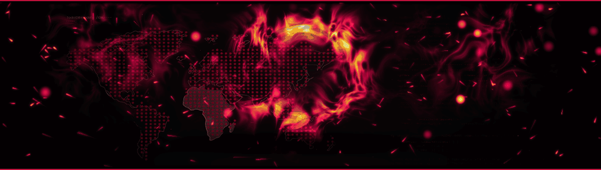
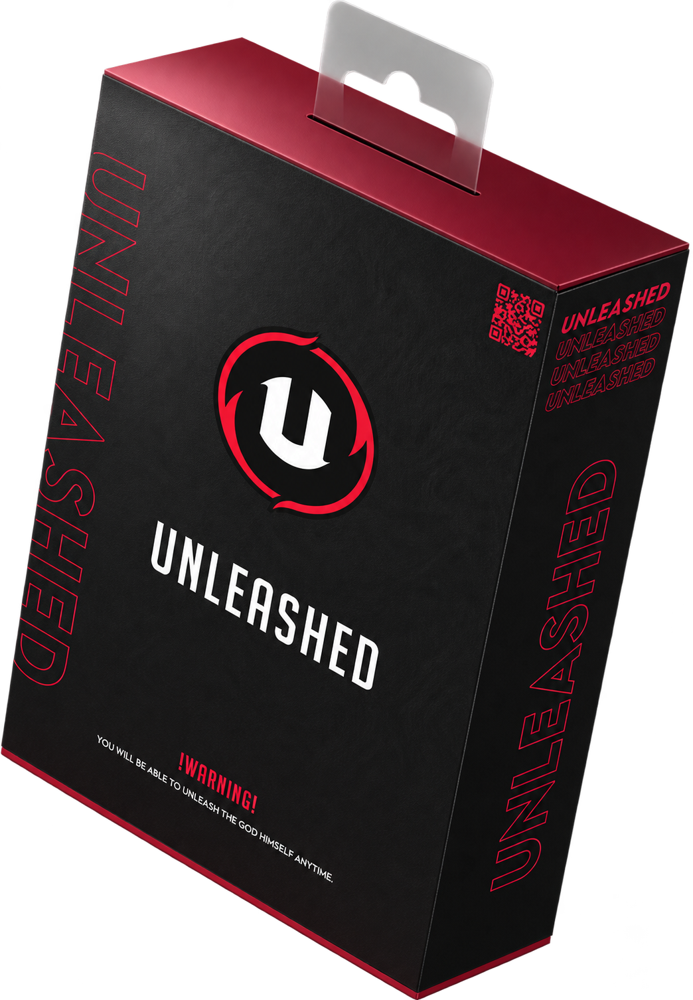
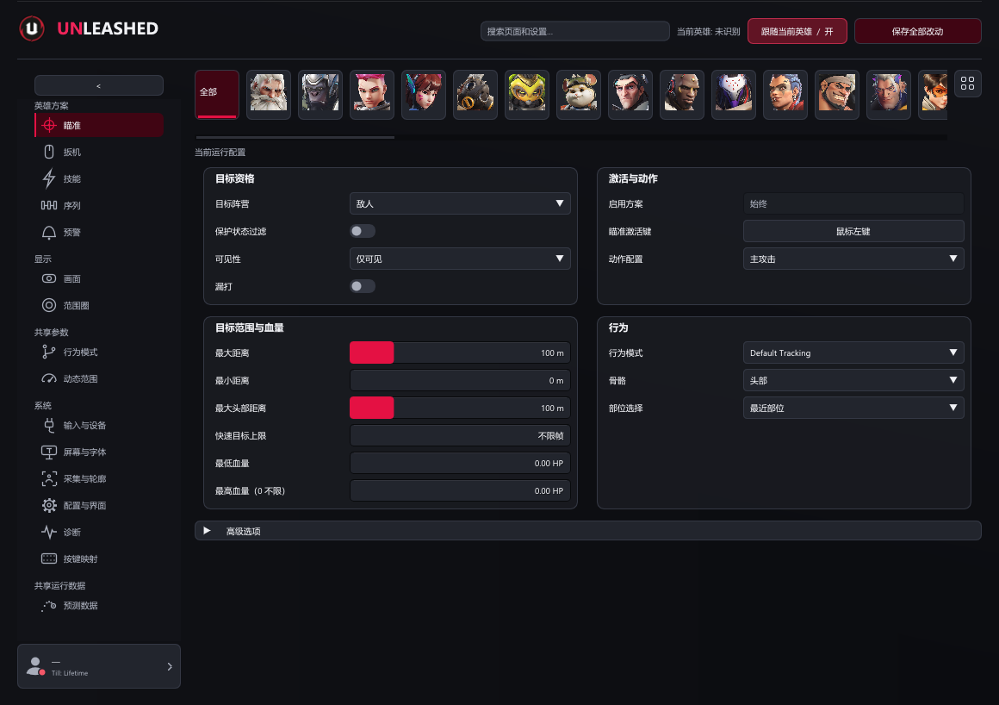
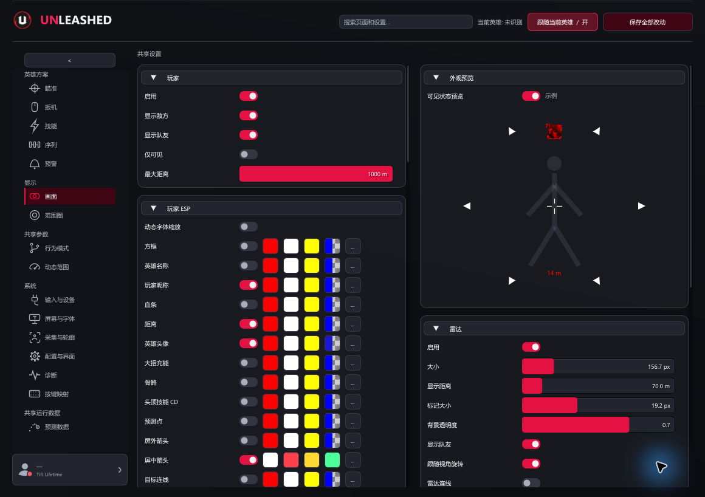
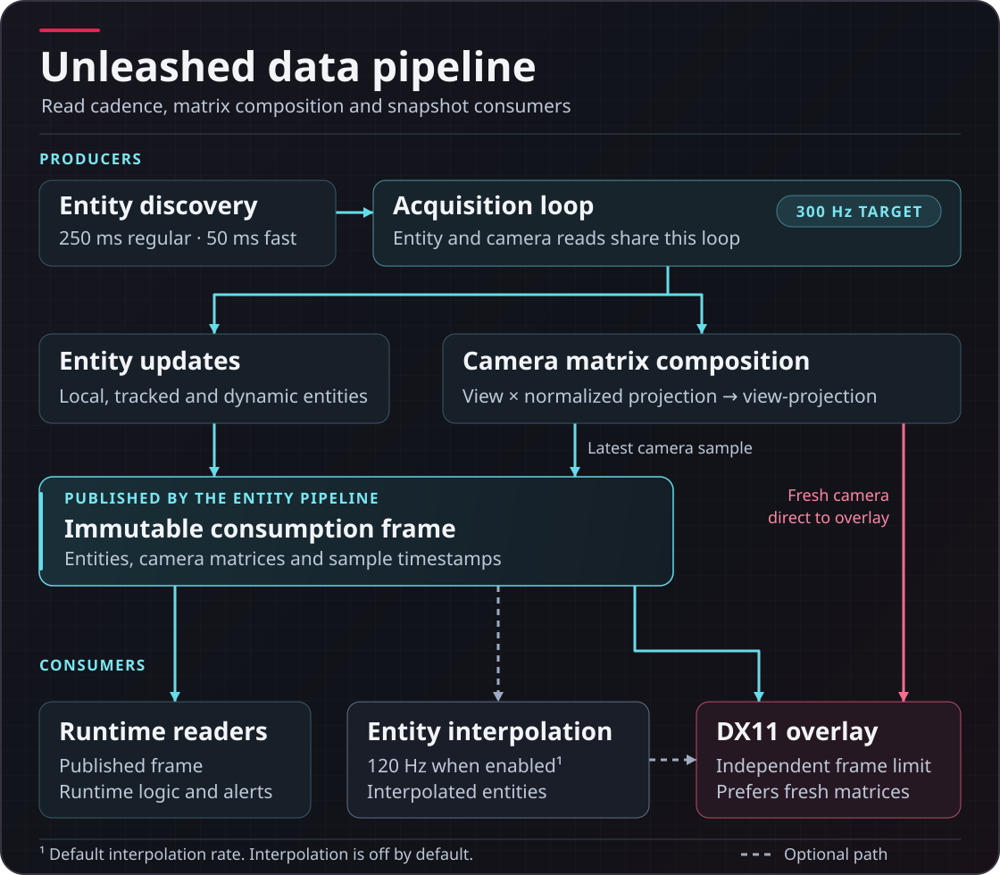

<div align="center">
  
  <h1>UNDMA V2</h1>
  <p><strong>Unleashed DMA · Overwatch 2 external research runtime</strong></p>
  <p>A readable, verifiable pipeline for acquisition, identity, targeting, behavior, motion, and output.</p>
  <p>
    <a href="./README.md">简体中文</a>
    ·
    <a href="https://github.com/RUC601/un-dma-v2">GitHub</a>
  </p>
  <p>
    
    
    
    
  </p>
</div>

<p align="center">
  
</p>

> A public-interest research project supporting the CN, KR, and International versions.

The latest builds are `2.25.1.0.155284N`, `2.25.1.0.155284KB`, and `2.25.1.0.155284` for CN, KR, and International, respectively.

## Preview

<p align="center">
  
</p>

<p align="center">
  
  
</p>

## Architecture

<p align="center">
  <a href="./assets/readme/pipeline.svg"></a>
</p>

Entity discovery maintains the roster. The acquisition loop samples entity and camera data at a scheduling target of **300 Hz**. The camera module multiplies the view matrix by the normalized projection matrix and publishes the result.

Entity publication bundles the latest camera sample into a read-only frame for runtime and rendering consumers. The overlay runs at its own frame limit and prefers a fresh camera sample. Entity interpolation is off by default and runs at **120 Hz** by default when enabled.

## Algorithm split

The core is described as four layers. They are decision boundaries, not four threads.

| Layer | Question | Typical contents |
| --- | --- | --- |
| **Target rules** | Who is eligible and where should the aim point be | team, health, distance, FOV, visibility, prediction, lock, continuity |
| **Behavior** | When should the action start, hold, fire, and cancel | `Tracking`, `Flick`, `Flick2nd`, `Reacquire`, `Magnetic Trigger` |
| **Method** | How should angular error become movement | `Linear`, `PID`, `Bezier`, `Piecewise`, `Hybrid PID`, `Shuwu`, `Koi` |
| **Output** | How should an action pass device and lifecycle gates | count conversion, queues, capabilities, epochs, ownership, release |

Useful reading entry points.

```text
include/Game/Target.hpp                 target candidate / visibility / prediction
src/Features/aim/BehaviorController.cpp behavior state / fire policy / cancellation
src/Features/aim/Smoothing.cpp           motion methods / per-thread controller state
src/Renderer/                            DX11 + ImGui overlay composition
src/output/core/                         scheduling / ownership / release
src/output/devices/                      KMBox / MAKCU / Ferrum / CatBox / Mock
src/ui/                                  console pages and configuration flow
```

## What is here

- **Profiles**: CN, Nexon, and World build identification and runtime selection
- **Configurable slots**: hero, Slot, Behavior, Method, FOV, target exceptions, migration
- **Overlay**: entity, health, contour, skill state, and diagnostic rendering paths
- **Output backends**: KMBox Net, KMBox Serial, MAKCU, Ferrum, CatBox, Mock, DHZ
- **Vision and alerts**: capture-card contour, ammo recognition, skill alerts, offline diagnostics
- **Packaging**: launcher, portable ZIP, config check, and runtime asset sync

## Run locally

```powershell
# native release
./build-release.ps1

# launcher + native runtime
./build-launcher.ps1

# start the V2 entry point
./start-v2.ps1

# read-only configuration check
./build/Release/UNDMA_V2.exe --config-check
```

---

**Developed and maintained primarily by ChatGPT**, with the goal of making technology accessible to everyone.<br>
**V3 is still in development**, with work underway on raycasting and algorithm compatibility.
