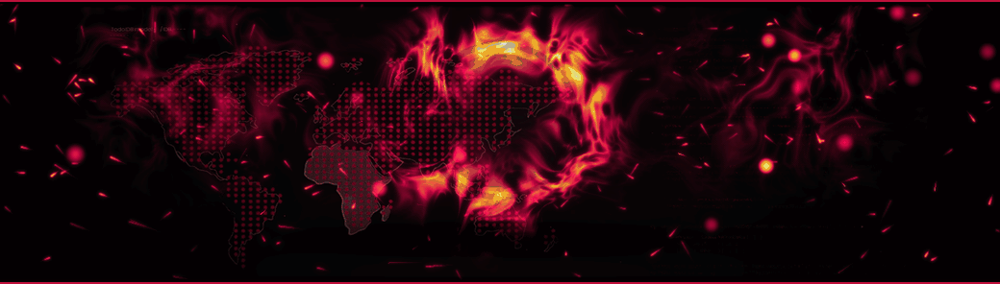
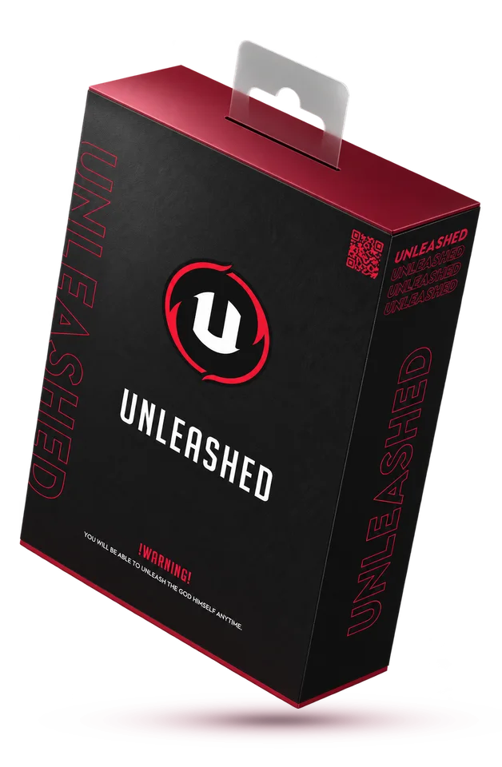
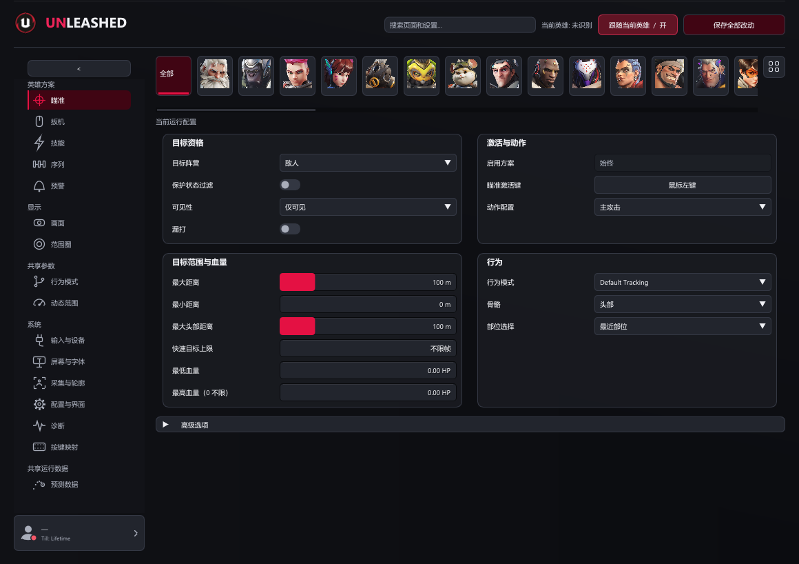
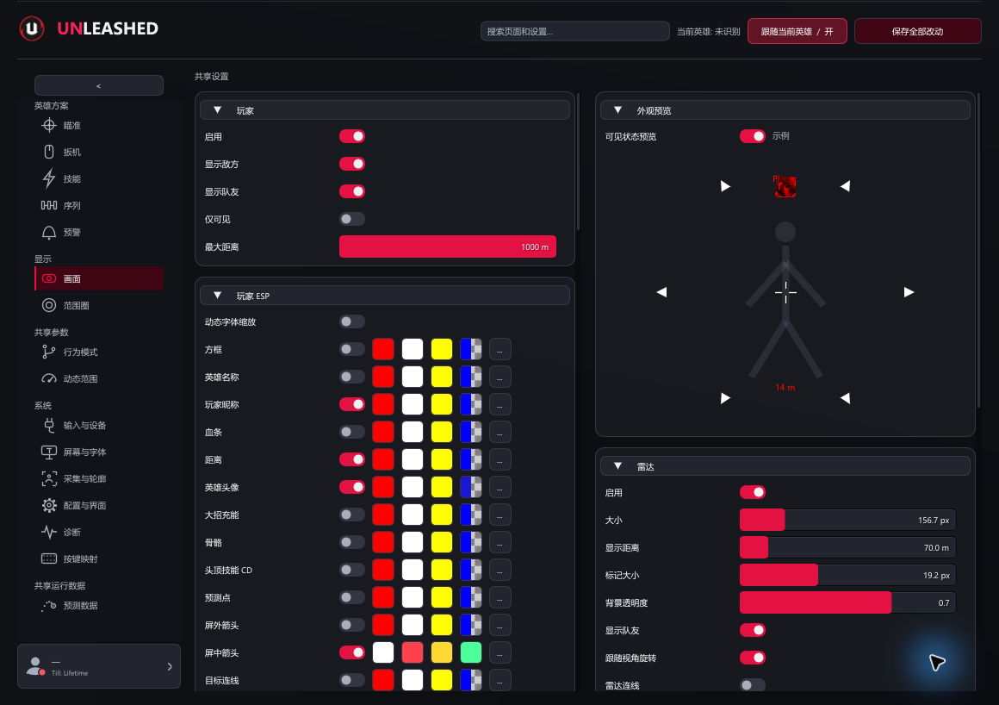
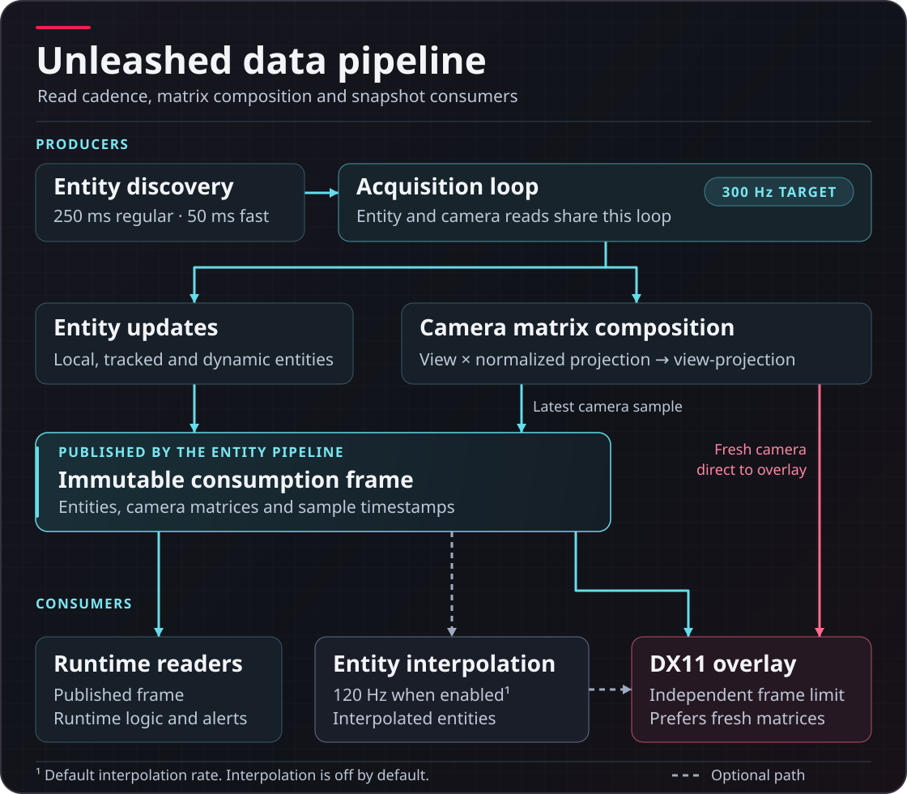

<div align="center">
  
  <h1>UNDMA V2</h1>
</div>

**Unleashed DMA · Overwatch 2 external research runtime**

把采集、身份、目标、行为、运动与输出拆开，做成一条可读、可验证的链路。

[English](./README.en.md) · [GitHub](https://github.com/RUC601/un-dma-v2)

   



> 公益研究项目。支持CN、KR、Internationnal 三版本。

最新版本为 `2.25.1.0.155284N`、`2.25.1.0.155284KB` 和 `2.25.1.0.155284`，分别对应 CN、KR和 Internationnal 。

## Preview

<p align="center">
  
</p>



## Architecture



实体发现负责维护名单。主采集循环以 **300 Hz** 为调度目标，处理实体和相机数据。相机模块用视图矩阵乘以归一化后的投影矩阵，发布合成矩阵。

实体发布端把最新相机样本装入只读快照，供运行时和渲染读取。Overlay 按自身帧率上限调度，优先读取新鲜的相机样本。可选的实体插值支路默认关闭，开启时的默认更新频率是 **120 Hz**。

## Algorithm split

UN 的核心拆分保持四层。它们不是四个线程，而是从候选到输出的四种不同决策。

| 层 | 回答的问题 | 典型内容 |
| --- | --- | --- |
| **Target rules** | 现在允许瞄谁、瞄哪里 | 阵营、生命、距离、FOV、可见性、预测、锁定与连续性 |
| **Behavior** | 什么时候开始、保持、射击和取消 | `Tracking`、`Flick`、`Flick2nd`、`Reacquire`、`Magnetic Trigger` |
| **Method** | 误差怎样变成角度增量 | `Linear`、`PID`、`Bezier`、`Piecewise`、`Hybrid PID`、`Shuwu`、`Koi` |
| **Output** | 动作怎样通过设备和生命周期门 | 计数换算、队列、设备能力、代次、所有权、释放 |

常用阅读入口如下。

```text
include/Game/Target.hpp                 target candidate / visibility / prediction
src/Features/aim/BehaviorController.cpp behavior state / fire policy / cancellation
src/Features/aim/Smoothing.cpp           motion methods / per-thread controller state
src/Renderer/                            DX11 + ImGui overlay composition
src/output/core/                         scheduling / ownership / release
src/output/devices/                      KMBox / MAKCU / Ferrum / CatBox / Mock
src/ui/                                  console pages and configuration flow
```

## What is here

- **Profiles**：CN、Nexon、World 的版本识别与运行时选择入口
- **Configurable slots**：英雄、Slot、Behavior、Method、FOV、目标例外和保存迁移
- **Overlay**：实体、血量、轮廓、技能状态和调试诊断的 DX11/ImGui 绘制路径
- **Output backends**：KMBox Net、KMBox Serial、MAKCU、Ferrum、CatBox、Mock、DHZ
- **Vision and alerts**：采集卡轮廓、弹量识别、技能预警和离线诊断入口
- **Packaging**：Launcher、portable ZIP、配置检查和运行时资源同步

## Run locally

```powershell
# native release
./build-release.ps1

# launcher + native runtime
./build-launcher.ps1

# start the V2 entry point
./start-v2.ps1

# read-only configuration check
./build/Release/UNDMA_V2.exe --config-check
```

---

**主要由 ChatGPT 开发维护**，立志技术平权。<br>
引入射线检测和算法兼容的 **V3 还在迭代中**。
