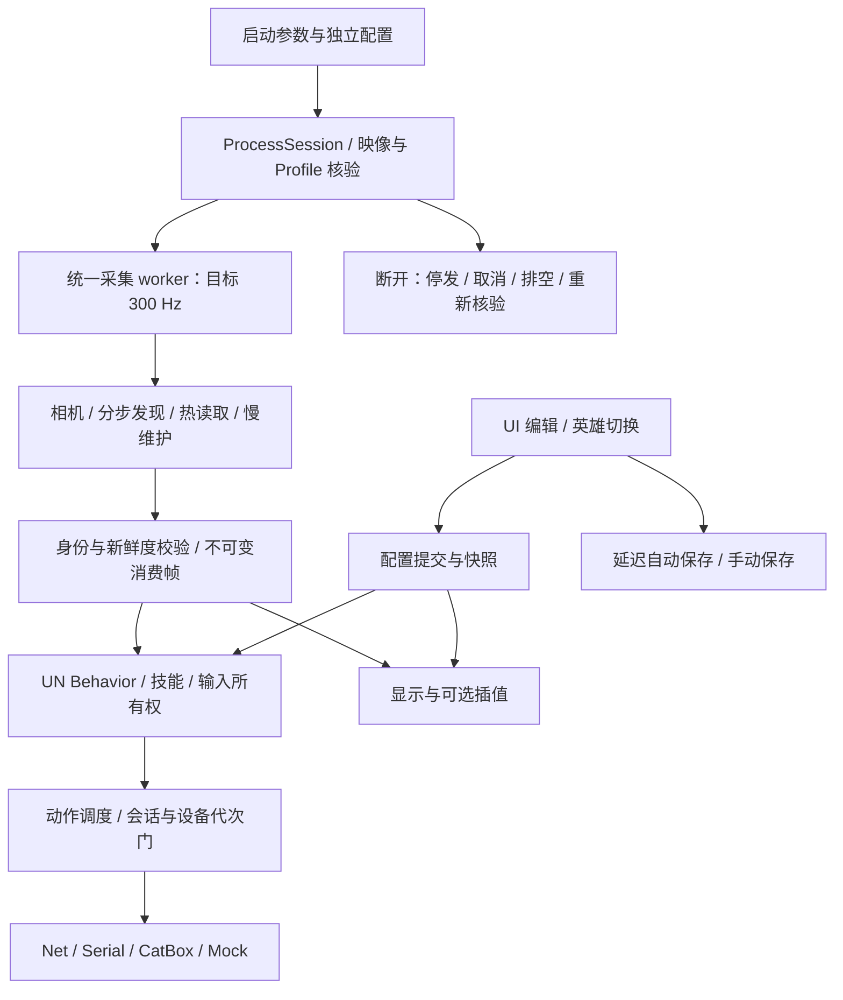

# UNDMA V2 开发手册

更新：2026-11-03。起始审查基线：`8f7a5e5df77b3f36190dbc241e5c8b420a17e3f4`，分支 `v2/framework`。当前包含本日 F1–F3、C1–C3 未提交修复；修复与验证记录见文末。

本手册只维护 V2。此前 UN 开发文档归 V1/继承历史，不作为当前 V2 的实现说明；不移动或改写 V1 材料。实现以本仓库代码为准，验证以对应版本、日期的证据为准。

2026-11-04 当前 CN 为 `2.25.1.0.154905N`，偏移与版本身份由 `include/Game/Cn154905.hpp` 维护，`src/Game/profiles/LayoutProbe.hpp` 的 CN 相机候选也引用同一组常量。静态与只读现场证据见 `../../../03_DOWNP/2.25.1.0.154905N/cn/offset_work_2026-11-04/handoff_latest.md`；视觉、死亡切换与长跑范围见对应进度记录。

## 目录与维护责任

| 范围 | 当前位置（相对 ECS_O） | 责任 |
|---|---|---|
| V2 产品 | `01_PRODUCTS/un-dma-v2` | 产品源码、资源、构建入口、开发文档；独立 Git 仓库 |
| V1 产品 | `01_PRODUCTS/un-dma-v1` | 独立维护 CN V1，不是 V2 的共享运行依赖 |
| V2 测试与证据 | `04_SCENARIO/un-dma-v2` | `src` 测试、`cmake/SelfTests.cmake` 注册、`build/selftests` 产物、`reports` 记录 |
| V2 研究 | `02_RESEARCH/un-dma-research/v2-product-research` | 资料、协议来源、历史和取舍，不持有产品运行代码 |
| 静态样本与偏移证据 | `03_DOWNP` | dumps、分析、偏移交接；`vertifytool` 持有只读实测工具 |
| 实验 B/C | `06_ARCHIVE/un-v2-experiments-20261030` | 冻结历史；C 的选定实现已进入 V2 |

根目录为 `D:\Desktop\SenseZen\ECS_O`。V1/V2 已于 2026-11-02 拆为独立仓库，旧说明中的共享 worktree/Git 数据库仅是历史。不得把 ECS_O 建为总仓库，也不得连接两版的活动配置、build 或 logs。

阅读顺序：本手册 → [代码阅读地图](V2_CODE_MAP.zh-CN.md) → 对应模块源码及 Scenario 测试 → [实施进度](V2_PROGRESS.zh-CN.md) 中的实际证据。[改造总纲](V2_REFACTOR_PLAN.zh-CN.md) 说明目标，[能力表](V2_CAPABILITIES.zh-CN.md) 记录来源和边界；旧日期的状态不能覆盖较新的实现。

2026-11-04 行为模式：`AimBehaviorMode.hpp` 定义命名模式默认值和 Slot 按模式/行为/算法保存的参数缓存；`Config.hpp/.cpp` 解析结构、迁移与持久化。`AimResponseCurve.hpp` 是误差响应曲线图形及运行的共用求值器；算法编号追加为 8。`BehaviorController.cpp` 统一三个 Flick 类行为的按下/手动释放/自动蓄力动作，辅助键松开后执行保留原 Slot，支持无目标直接出手。`BehaviorTuningEditor.hpp` 和 `ResponseCurveEditor.hpp` 在模式管理及 Slot 页复用。英雄配置 schema 18 的独立 `releaseConfigVersion` 避免模式缓存归一化提前吞掉旧 Hanzo 迁移标记；新配置默认显式关闭松开发射。详见 [行为与曲线说明](V2_AIM_PLANS.zh-CN.md)。

## 完整业务流程

2026-11-05 Overlay：`src/Features/visuals/HeroStatusHud.inl` 绘制整组英雄状态，`SlotStatusHud.inl` 绘制精简 Slot，均由 `EntityVisuals.cpp` 持有；`SceneRenderer.cpp` 绘制 ED 信息与头像雷达。显示 → 画面 → Overlay 元素的样式由 Global.heroStatusStyle（0=ED，1=自定义）持久化，旧 ult 开关管整组状态；showOverlayInfo、showSlotStatus 管固定 ED 的两项开关。世界技能 CD 在头顶显示，旧 skillDisplayMode 配置键仅兼容保留。`OverlayStatus.hpp` 共用三格布局、连续生命分色和显示 CD 新鲜度；EntityReader 的 display_cooldowns、display_ultimate_tick 仅用于显示，不延长身体权限。第三技能数值缺源则显示 --，其他玩家前两项 CD 的现有键路径尚需逐英雄实机核对。实施与现场边界见 [Overlay 记录](../../../04_SCENARIO/un-dma-v2/reports/overlay-hud-20261105/RESULT.zh-CN.md)。

2026-11-04 默认行为模式：system schema 16 / hero schema 19 为 Aim Slot 保留 `Default Tracking`、`Default Flick`、`Default Flick2nd`、`Default Reacquire`、`Default Magnetic Trigger`。Slot 仅选择命名模式，移除 Custom 入口；新增 Slot 一律选中 Default Tracking，默认停用、清空两类按键绑定。五个默认模式有持久化固定标识，改名后仍受保护，禁止删除和改变基础行为；算法及默认参数仍可编辑。模式库为五个默认项预留容量，不挤掉已有 64 个用户模式。旧未命名 Slot 按原行为/算法补齐引用，保留独立参数；先保存模式定义再保存 Slot 引用。



这是进程内模块划分。300Hz 是采集调度目标，不代表成功 DMA 读取、每个实体的慢字段、绘制或物理输出均达到 300Hz。

画布由 `Renderer/Overlay.cpp` 独立消费已发布数据，使用不透明黑底和 `Present(0,0)`。系统→配置→应用的“绘制帧率上限”对应 `Global.overlayFrameLimit`（0=不限帧，1–2000为目标上限），即时生效并自动保存；“实际绘制帧率”使用诊断帧计数。`Renderer/FrameSchedule.hpp` 保持画布截止时间，Win32高精度计时器负责等待；低画布帧率不会拖低约60Hz菜单或阻塞恢复热键。收起整层时仍暂停绘制。绘制吞吐与显示刷新率、300Hz采集和最新数据频率分开解释，设为2000不保证实际达到2000。

### 启动、会话和停止

`src/main.cpp` 解析参数。`--config-check` 和编入的自测入口在正常设备/线程启动前返回。配置检查会调用真实加载与迁移，**目前不是不写盘的校验器**，见下方已知缺陷。

正常启动加载独立配置，由 `src/runtime/ProcessSession.cpp` 创建连接线程。该线程先初始化输出，再处理 DMA 建连、健康检查、目标进程发现、映像核验及 Profile 路由。CN 是完整业务路径；KR=Nexon、BZ=普通国际服。候选需显式选择并通过匹配，只运行候选读取，不启动 UN 行为/输出。相机匹配不等于完整适配。

`WorkerGroup` 持有线程及异常状态。运行组包括统一采集、Behavior、英雄配置切换、技能运行和可选显示插值等；按键采样另有生命周期。worker 异常会进入会话失败处理。

断开/退出先关闭正常输出授权、请求停止和取消，等待调度清理及线程返回，再关闭 DMA/设备资源。`Memory` 会话门阻止新操作并等待在途访问排空。停止标志、线程返回、join 完成、资源关闭是不同事实；不能因代码有 join 就宣称 SDK 永久阻塞可取消。目标进程/DMA 恢复与外设恢复有不同入口，连接循环目前不周期性 reconcile 外设。

### 统一采集、身份和身体有效性

入口为 `src/Game/entities/EntityReader.cpp::entity_thread`，节拍在 `src/runtime/Acquisition.hpp`。每轮先等待节拍，调用 `SampleAcquisitionCamera`，再推进发现、热字段与预算内慢维护；预算不能抢占已经进入的外部调用。

- `EntityDiscovery.cpp` 保存可恢复 cursor，分步读取验证；当前 worker 固定 latest-wins/cold topology。旧环境开关不是其策略控制源。
- `RegistryResolver.hpp` 管候选根、语义核验、预算和会话变化。读完表与获得删除旧名单权限分开，部分/失败/空结果不随意获得完整删除权。
- 热读取使用批量缓冲；慢维护处理组件、身份、骨骼等。周期更新与布局/MatchId 核验用于应对组件搬家，禁止重建后继续套旧批量结果。
- 死亡字节统一为 `Health+0x5C0`，每轮热批量读取，完整 0/1 才可使用；死亡优先于位置/骨骼处理并撤销身体与目标锁。血量分项仍为 16ms，死亡未知不刷新存活依据；身体还要求死亡状态在 100ms 内。其他地区统一偏移是用户指定假设，实服未验。
- 玩家身份来自 `LinkParent` 的 `0x24` 组件和 `+0xE0` 引擎字符串对象（长度 `+0x10`，存储字段 `+0x14`，支持内联与长字符串）。身份保存在持久 owner record，当前控制器配对接替同一 BattleTag 的身体与英雄，不派生重复玩家席位；机器人保留原实体身份规则。
- 身体采用依赖当前配对、发现证明、组件版本和身份权限。2026-11-03 实现保留同一已确认配对的队伍约束，真实配对替换才重新确认，未知不默认敌方。
- 本地实体也经过空间、身份与身体接纳；消费帧基于当前已确认本地队伍计算关系。

| 状态 | 职责 | 不能替代什么 |
|---|---|---|
| connection epoch | 区分连接会话 | scene 内实体身份 |
| scene generation | 区分场景换代 | 配对/组件有效性 |
| 注册表及删除权限 revision | 防止旧扫描删除新发现 | 身体字段新鲜度 |
| actor/body authority 与配对 | 防止旧身体/旧结果复活 | 实际位置样本的时效 |
| 100ms 身体窗口 | 约束当前可消费身体 | 名单保留期 |
| 13s 席位保留 | 暂时不可见对象的身份连续性 | 允许旧身体继续动作或正常绘制 |

这些状态不能按名字相似就合并。修改时要追踪发布、撤销、迟到读取和消费端。

### 相机、快照与显示

`src/Game/camera/CameraWorker.cpp` 由统一采集调用，不再有独立高频相机线程；链由 Profile 决定，采集线程持有句柄，无效矩阵不作为有效样本发布。

`src/Game/snapshots/SnapshotAccess.hpp` 提供 `ConsumptionFrame`、`SnapshotFrame` 和 scoped 消费上下文。帧通过 `shared_ptr<const ...>` 发布，消费者持有其生命周期；矩阵和身体仍要检查新鲜度、epoch、scene。不可变保证内容不被并发改写，不保证内容永远新鲜。

持续动作循环也有刷新消费帧的路径，不能只看外层作用域就推断一直使用首帧。`PresentationWorker` 和 `features/visuals` 管插值与画面，不应以显示插值延长动作身体权限。模型形状加载成功不证明像素对齐或伤害碰撞意义。

### Overlay 与桌面切换（2026-11-04）

画布与设置菜单是两个独立 Win32 窗口。菜单失焦不再最小化整层：切到外部进程时取消两窗口的置顶并将其放到其他窗口后面，保持可见状态及后台运行；回到设置菜单时先抬起画布、再抬起菜单。主循环也检查前台窗口，覆盖菜单已被 Home 隐藏的情况。画布和菜单的尺寸刷新必须带 `SWP_NOZORDER`，防止外部应用正在前台时重新抢占显示层级。

启动显示修正：正式 Release 使用 Windows GUI 子系统及现有 `main` 入口，不再创建日志控制台；文件诊断保留，自测构建仍使用控制台。黑色全屏画布接收点击与激活，不再把空白点击传给桌面；Home 关闭设置时将焦点留给画布。启动/返回 UN 时重新抬起画布和菜单，并使用 Windows `ITaskbarList2::MarkFullscreenWindow` 标记当前展示为全屏，使任务栏在 UN 活跃时让出前台。切出和显式最小化时解除该标记；不修改系统任务栏设置。

Home 仍只切换菜单；显式 Minimize Overlay 才隐藏画布并最小化菜单，之后 Home 或任务栏恢复两层。正式窗口状态实现为 `src/Renderer/OverlayWindow.cpp`，消息与循环在 `Overlay.cpp`，原生窗口回归位于 Scenario 的 `src/OverlayWindowSelfTest.cpp`。隔离桌面检查不等于真实 Win/Alt+Tab 或游戏场景验收。

### UN Behavior、技能和 Slot

`src/Features/aim/BehaviorController.cpp` 管激活、方案选择、目标连续性和各 Behavior；`SessionState` 保存运行状态；`Smoothing`/`Target.hpp` 提供 UN 选择和运动算法。技能位于 `HeroSkills`，通过统一动作/所有权系统输出。

Skills 页顶部三个共享旧功能并非英雄占位项：Auto Alt-Fire 按目标血量与距离点一次右键；Auto Skill 只对代码中列出的英雄执行低自身血量动作，未包含铁拳的出拳；Auto Shoot 控制旧 `shooted` 状态的重复开火间隔。英雄专属技能在下方独立配置。

2026-11-04 铁拳 Rocket Punch：`include/Game/DoomfistPunch.hpp` 保存单次物理右键蓄力窗口；`src/Game/HeroSkills.cpp` 的 `EvaluateRocketPunch` 串联原始物理输入、候选筛选、水平瞄准与释放。默认停用；在技能页选末日铁拳并启用 Rocket Punch 后，先松开一次右键，再手动按住右键蓄力，按下 Mouse4 请求本次辅助。默认距离 15 米、脚下位置高差上/下各 2 米、FOV 30 度、预计满蓄力 1000ms、预计自动出拳总持有时长 2000ms、提前 80ms 截止；在截止前观察到已对准才屏蔽物理右键并输出释放，持续持有不重复执行。蓄力/辅助输入读取 DMA KeyState；原始物理报告仅用于释放后的恢复，无报告时屏蔽 80ms 后恢复，有效物理按住报告最多保留 2 秒。恢复后等待 100ms，并在右键及辅助键都松开后重新激活；停止、换英雄/场景/设备或异常均清理。辅助请求期间暂停普通 Aim/Trigger 的竞争输出。

该流程需要输出设备提供鼠标屏蔽能力和有效 DMA 按键样本，不再将设备原始鼠标报告的新鲜度设为启动门槛；KMBox Net 已接入统一输入快照。上下高差使用实体 `pos.Y`，水平距离使用 X/Z；仅改 yaw，不改 pitch。满蓄力仅影响拳速/距离估算，截止按自动出拳总持有时长计算，蓄满后的保持阶段仍允许辅助。2000ms 是可调整的试验估值，不声称已测得当前游戏的自动出拳时刻。蓄力计时来自按键输入而非已验证的游戏蓄力字段；普通拳的 20 米满蓄力范围及 15–35m/s 速度沿用本地候选模型，按蓄力比例保守限制可达距离，强化拳和楼梯/墙体通行未建模。日志前缀 `doomfist.punch`。旧自动蓄力配置首次加载迁为停用的新默认设置，需重新启用；普通 Aim 的武器 `ManualOnly` 约束保留。离线自测不证明实机出拳效果。

Behavior 决定动作规则，Method 决定运动方式。Tracking、Flick、Flick2nd、Reacquire、Magnetic Trigger 的含义及参数关系仍属于 UN，不按其他产品分类改写。英雄局部 override 不应改变全局持久化参数。

2026-11-04：Tracking / Magnetic Trigger 的瞄准时限由 `AimHoldWindow` 按实际激活键保存，首次选中并观察到按住时固定起点和预算。换目标、丢目标、同键 Slot 切换或运动清理不续时；有效按键样本确认松开后才重新激活，缺失样本不当作松开。普通 Flick 的连发时间线保持原语义。

Slot 显示下标与稳定 ID 分开：重排不变身份；新增复制参数、清绑定、默认停用并分配新 ID；删除/替换使旧运行引用失效。同一武器冷却不能靠换 Slot 清零。UI 选中方案不等于业务已激活。

## 输出所有权与恢复

2026-11-04：KMBox Net 的 `cmd_unmask_all` 使用 `head.rand=0` 表示清除屏蔽；`KmBoxNetBackend::BuildPacket` 统一保证该字段为零，不能将其当作普通命令的随机字段。正常恢复、超时清理及退出安全释放共用这条约束；OutputLifecycleSelfTest 检查实际输出包。铁拳解除屏蔽失败时保留待恢复状态，常规日志 `doomfist.punch restore accepted=...` 可追踪恢复结果。

| 所有者 | 入口 | 责任 |
|---|---|---|
| 业务动作 | `src/output/Actions.cpp`、量化/运动模块 | 业务意图转移动/按键/释放，不直接管理设备生命周期 |
| 调度/所有权 | `Game/OutputScheduler.cpp`、`InputOrchestrator`、`OutputOwnership` | 合并持有者、定时序列、取消与释放，共享控制不能提前释放 |
| 输出 runtime | `src/output/OutputRuntime.cpp` | descriptor、能力、应用状态、generation 与分发门；切换先清理旧会话 |
| 传输 | `KmBoxNetBackend`、`SerialTransport`、`CatBoxBackend`、`MockBackend` | 协议、队列、完成状态、物理输入监听与关闭 |
| 生命周期接线 | `DeviceConnection.cpp`、UI 设备应用、英雄配置 worker | 依据配置显式 reconcile/释放/停止 |

持久化设备编号：0 KMBox Net，1 KMBox Serial，2 Mock，3 MAKCU 4M，4 MAKCU 115200，5 Ferrum，6 CatBox。旧 `[KMBox]`/`kmbox*` 是配置兼容，公共代码在 `src/output` / `include/output`；不恢复旧转发目录。Controller/Medius 等未实现项不能冒充可用。

入队接受、写入完成、设备实际执行是不同事实。断连关闭正常分发；旧 generation 不进入新会话；安全释放不能新增按下。串口使用 `SendCommandOrFailSession`：仅发送一次，失败关闭会话并结算待处理命令，不重放失败移动。Net 重发是否由固件去重仍需设备证据。

当前 Net 在 Running 状态失去连接后，`EnsureConnected` 不重连，需 runtime 显式重建；设备应用或英雄切换可触发，网络恢复本身不会触发。历史日志“attempting reconnect”与此不符。是否恢复自动重建须先明确契约，并保留清队列/新 generation，不能仅移除门控。离线协议/Mock 测试不能证明各设备的物理效果、固件差异、时延和长跑。

## 武器与技能基础数据（2026-11-04）

基础游戏定义随程序编译。`WeaponSpec.cpp` 维护武器、弹速、蓄力与命中半径；`ProjectilePhysics.hpp` 用稳定武器／技能ID维护实际重力、世界向上方向偏置和施放延迟。`WeaponCadence.cpp` 的75条 `constexpr` 周期记录不再读外部TSV，不再接受 `UNLEASHED_WEAPON_CADENCE_TSV`，也不回退源码路径。未知周期保持未知，原有业务回退仍处理缺项。几何与技能目录原已在C++中。

普通瞄准、Trigger与已有技能预测通过统一弹道计算使用数值重力；零重力解直线拦截，有重力取最早正实根，无解保留原始瞄点。求出的弹丸方向再反算视线方向，抵消 `normalize(view + delta * worldUp)`；原始瞄点与用户配置不被改写。技能保持已有参数覆盖规则，编译物理参数沿现有消费链传入，不新增技能执行器或自动施放策略。

Pluz原始工作簿、公开整理版、完整源码与历史归 `02_RESEARCH/un-dma-research/v2-product-research/pluz-ballistics-20261104`；旧产品data资料归同级 `weapon-data-sources-20261104`，两处均从ECS_O定位。产品和构建不依赖研究目录。历史参考弹速不覆盖现行值，环境碰撞半径不替换英雄命中半径，未覆盖项保留原参数。托比昂补偿获用户反馈有效，其余旧物理值仍待当前CN现场验证。

## 配置：编辑、生效和落盘

运行配置在 EXE 旁的 `build/Release/config`，启动脚本将工作目录设为程序目录。系统参数为档案 INI，英雄参数为同名 `.heroes.json`，DMA 参数单独存储。模板构建不应无条件覆盖正式配置。

1. UI 使用 `ScopedConfigEdit`，修改局部视图后在锁内差异提交；Slot 命令通过 `HeroSlotStore`。worker scoped 读取来自已发布配置，英雄 override 是局部运行参数。
2. 编辑影响运行快照，落盘另行处理。读/编辑作用域仍保留所需副本；差异提交只有实际改变或引用修复时才发布。只读 getter 和空闲自动保存轮询不再主动发布；查询会先提交尚未生效的 UI 编辑，真正保存仍校验并发布，保留原有可见时点。不是零拷贝配置。
3. 自动保存默认开启：持久化内容最后变化后等待 4 秒，继续编辑重新计时，恢复到已保存值不写盘；失败保留待存内容并每 4 秒重试。手动立即保存，正常退出补存。
4. 英雄切换先保存前一英雄，失败延后；`LoadConfigForHero` 从内存英雄存储选择方案，不每次重载整份磁盘档案。
5. `FileTransaction` 对单文件临时写入、Flush、替换。INI 与 JSON 依次保存，不是跨文件事务；后一文件失败明确报告部分成功。

加载先区分英雄 sidecar 缺失与读取/解析失败。只有缺失且 INI 存在旧英雄节时才迁移；有效空 JSON 仍是该档案的权威数据，不借旧 INI 回填。损坏或读取受阻时保留当前内存与磁盘，记录失败路径；自动、退出和手动英雄保存均不能覆盖它，成功重载后解除保护。

`LoadConfig` 返回 `ConfigLoadResult`：`Failed` 未加载新档案；`Loaded` 正常完成；`MigrationSaveFailed` 已加载新档案但迁移写盘失败。UI 对前者恢复旧档案名，对后者保留新档案及待存状态并报告失败，避免把新参数写入旧档案。启动与 `--config-check` 对未完全成功返回非零。合法旧版本检查仍可能执行迁移，故 `--config-check` 仍只在隔离副本验证，不能称为只读命令。

诊断 effective 策略来自当前统一采集：目标 `acquisition_target_hz=300`、整数目标周期 `3333µs`；旧环境开关不能改变这些值。实际 Hz/age 仍来自计数器。`critical_batch_fusion_*` 和 `viewmatrix_poll_sleep_ms` 保留旧兼容含义，不用它们推导实际采集节拍。

## 构建与验证入口

更新 offset/profile 后的靶场验收必须包含动态血量：观察持续被敌方攻击的两个友方机器人，连续核对当前血量下降、同一身体最大血量稳定、死亡与重生状态，以及 overlay 是否同步跟进。按实体身份/身体代次分开记录，避免把重生或更换实体当作同一身体血量跳变。满血截图、字段可读或离线自测不能代替这一项；未采到的阶段注明待验。原始字段证据归 `03_DOWNP/vertifytool`，运行和画面证据归 `04_SCENARIO/un-dma-v2`。这是用户于 2026-11-04 指定的后续版本验收要求。

在产品目录执行：

```powershell
# 正式程序：build/Release/UNDMA_V2.exe
./build-release.ps1

# 离线测试产物在 Scenario，不进入产品 build
./build-release.ps1 -Tests

# 成功构建后，使用 VS 附带或已入 PATH 的同版本 ctest
ctest --test-dir ../../04_SCENARIO/un-dma-v2/build/selftests -C Release --output-on-failure
```

脚本查找 Visual Studio Community 2026 的 CMake。正式 target 仍名 `Unleashed`，EXE 为 `UNDMA_V2.exe`。正常入口 `./start-v2.ps1`，显式 TestServer 默认 19560，V1 为 19550；两版不能并发占同一 DMA。

`UNLEASHED_OBSERVATION_ONLY` 是关闭物理输出/目标写入的编译选项；观察构建与证据放 Scenario，不覆盖正式程序。TestServer 未 arm 仅限制该 API 写入口，不表示普通程序业务输出全部关闭。屏幕流源身份固定：主机 UDP 9808，本地/副机 UDP 9809。

### 2026-11-03 起始只读审查状态（修复前）

| 项目 | 结果 | 边界 |
|---|---|---|
| 完整自测构建 | 4 目标失败：DiscoveryFairness、EntityRegistryRelocation、EntityRegistryProducer、HealthFailure | 对应 7 个用例未运行 |
| 其余 CTest | 43 项运行，42 通过，HeroSkillConfig 失败 | 不能写成全套通过 |
| HeroSkillConfig 定位 | 仅加失败行号的隔离副本报原测试 377 行 | 旧 E 键断言与已记录的回声右键默认值变更失配 |
| 隔离配置检查 | 损坏英雄 JSON 被覆盖，退出 0 | 确认加载失败处理缺陷，不是有效配置验收 |
| 正常 DMA/外设会话 | 本轮未运行 | 不新增实机、视觉、性能或长跑结论 |

详见 [只读审查报告](../../../04_SCENARIO/un-dma-v2/reports/readonly-audit-20261103/REVIEW.zh-CN.md)，含调用链、精简建议、反证及未查范围。此前新构建 21 分钟现场观察留在 [实施进度](V2_PROGRESS.zh-CN.md)，不能与本轮离线结果拼成超过 40 分钟或全部场景通过。

## 按修改风险选择验证

| 修改入口 | 要追踪的调用/失败路径 | 最贴近的已有验证 |
|---|---|---|
| 配置/Slot | UI、英雄切换、迁移、自动/退出保存、快照并发 | ConfigPersistence、ConfigConcurrency、AimPresetConfig；含损坏/受阻加载保护与失败迁移待存 |
| 实体/发现/缓存 | 完整/部分扫描、迟到结果、配对替换、搬家、消费权限 | EntityRepair、Lifecycle/Registry/Health；覆盖 fairness/relocation/late-result |
| 输出/协议 | 入队→发送→完成→取消→释放→换代 | OutputQueue、Lifecycle、RuntimeSwitch、InputOwnership、OutputProtocol；实机另验 |
| Behavior/运动 | 参数语义、激活/释放、循环刷新、目标/Slot 失效 | Tracking/Flick/FirePhase/Hybrid/Prediction/Cadence；手感和全英雄另验 |
| 会话/内存 | 进入门、等锁、排空、worker 异常/返回 | RuntimeControl、MemoryDeviceRecovery、V2Recovery；拔插/永久阻塞另记 |
| 显示/诊断 | 同帧消费、新鲜度、插值、指标来源 | PresentationTiming、Overlay、ModelShapes、TestServerLifecycle；含旧开关 0/1 与 CN/BZ effective 响应（两者当前为长链） |

生产与测试仍通过部分 `.inl` 共享实现。改动局部类型、容器所有权或失败状态时要检查外部 fixture，正式 EXE 可编译不代表测试可编译。每次记录源码/程序版本、运行模式、实际命令结果、证据位置和未覆盖范围。静态确认、离线执行、真实连接、物理动作、画面对齐、长期稳定分别记账。

有实际竞态窗口的重复检查应保留依据；无变化发布、死分支和失效包装可逐项小步精简。不要借整理改动 UN 的业务语义，也不先建设大框架。


## 2026-11-03 审查项修复后的验证

F1–F3、C1–C3 已按本日用户指示处理。全套自测构建成功，50/50 CTest 通过；配置持久化 79/79、配置并发 38/38。正式 Release 重建成功，新 EXE 的隔离合法配置检查退出 0，截断/数组根英雄 JSON 均退出 1且文件不变。正式配置 5 份文件保持原散列。

F2 fixture 已接回共享 record、紧凑读取和不可变发布帧。布局变化立即撤销旧身体并整组重建，普通运输失败仍使用 100ms 宽限，13s 席位与迟到结果权限检查保留。空扫描没有删除权限。不得为了旧断言回退这些现行规则。公平性测试的历史调度驱动只保证所覆盖的共享边界；现行统一发现入口另由 `EntityRepairSelfTest` 直接执行，不把 4096 候选测试当成统一调度器端到端性能验收。

详细改动、断言调整依据、程序散列、保全和未覆盖范围见 [修复记录](../../../04_SCENARIO/un-dma-v2/reports/audit-fixes-20261103/RESULT.zh-CN.md)。本轮未启动真实 DMA/外设会话，不更新物理效果、UI 手工操作或长跑结论。
