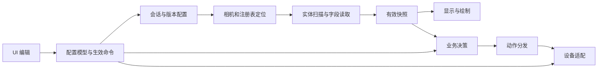

# UNDMA V2 改造总纲

2026-10-29 · 供本轮讨论和下一轮实施使用。基于当前 V2 `b357486`、V1 `aefada3` 及已归档的 Pure 研究。本文是方案；本轮交付为 V1 复核、桌面入口和 V2 规划，尚未实施 V2 架构改写。

同日用户补充已并入：保留 UN 自有算法、Behavior 定义和 Slot 业务语义；Pure 主要作为运行组织参考。本轮跑通并验证 CN，KR/BZ 先接入有来源的候选实现，实服验证后置。UI 改用已安装的 jakubkrehel/skills 新套件。后续目标模式贯穿本总纲各阶段，非全局阻塞记入未解决项后继续其他工作；全部完成或仅剩需要用户介入的事项时停止。

**目标：完成一个能实际运行、能使用的 UNDMA V2，同时让源码按业务清楚组织、便于人阅读。V1 保留现成运行环境；V2 大幅重构并直接推进到完整产品。**

交付应包括：可从桌面启动的正式 V2 程序；CN 的真实连接、采集、相机/实体、显示、UN 自有算法与 Behavior、现有设备输出的完整链路；接入运行时的新 UI、英雄/Slot 配置及保存重载；自动定位和版本识别等总纲中的新增能力。完成构建后实际运行、发现问题并修复，直到具备条件的功能跑通。KR/BZ 先接入候选实现，本轮实服验证后置。

模拟、回放和离线预览是可选调试工具，不能成为最终交付，也不必先做一整套模拟框架。研究和文档服务于写代码；遇到具体不确定项就解决该项，能采用合理自有实现的直接推进。下面的分工和顺序用于组织工作，不设逐阶段审批或另起任务的要求。

**一、先固定几项总原则**

- V1 来自原 NE，继续固定 CN；古老原 UN、Clean、BZ、Lite、Rust 已冻结归档。V2 继承 V1 的资源、已有功能和有效经验，自行组织代码，不把古老原 UN 的架构重新搬回来。
- V2 初期暂停“最小改动优先”的 Ponytail 取向。允许一起调整目录、接口、状态归属、配置和 UI，完成一条能运行的完整业务链。基础框架跑通后，再恢复小范围修复、控制改动面的节奏。
- Pure 提供采集、调度、快照发布、重连等已查明机制和对照材料；UN 自有算法、Behavior 定义、参数关系、英雄配置及 Slot 语义继续作为业务依据。允许重组算法代码和接口，但不能为套入 Pure 的结构而删减算法能力或改变行为含义。UI 根据 UN 的业务模型重新设计。
- 统一采用 CN=国服/NetEase、KR=Nexon、BZ=普通国际服。当前范围按用户约定聚焦 Battle.net 使用场景，Steam 后置；渠道、地区、构建号和内存布局在内部独立表达，避免把同一个枚举同时当成四种概念。
- V1/V2 保持独立源码工作目录、配置、构建、日志和运行产物；使用各自独立的 Git 仓库和历史数据库，分别提交。ECS_O 不建顶层 Git。V2 不通过回退或覆盖 V1 来试错。
- V2 对 Scenario 不作全量兼容承诺，也不把兼容任务交给偶然继承。阶段交付明确写“可用、未验证或暂不支持”；需要采集时再做薄适配或小工具。V1 维持既有能力。

借鉴边界：运行组织参考 Pure；算法和 Behavior 以 UN 已有探索为基础；Slot 沿用 UN 业务规则；UI 将这些能力重新组织呈现。流畅响应、稳定采集节奏和低抖动是 V2 的运行目标，用数据与实际体验检验，不以结构相似度验收。Pure 的样本表现不自动证明整套设计更稳定。

**二、Pure 值得借鉴的业务模块**

下表是面向 UN 的业务划分，不声称 Pure 的原始源码按这些目录组织。研究详情和证据入口见[研究与取舍](D:/Desktop/SenseZen/ECS_O/01_PRODUCTS/un-dma-v2/../../02_RESEARCH/un-dma-research/v2-product-research/V2_RESEARCH_NOTES.zh-CN.md)。

| 模块 | 可采用的设计 | V2 的处理 |
|---|---|---|
| 版本识别与 Profile | 逐个尝试相机链，以组合矩阵有效性判断配置兼容 | 建立识别框架并跑通 CN；KR/BZ 按已有证据接入候选实现，标为未验证，本轮不作实服验收 |
| 实体注册表根定位 | 缓存候选、已知位置验证、失败后搜索新根 | 首批重点新增；与表内扫描分开，可接收 Dumper 候选 |
| 实体扫描与拓扑 | capacity 驱动、分块/跨 tick 推进、提交前复核 | 继承 UN 的动态表与迁表处理，补清晰的 Scanner 边界；不重复造已有机制 |
| 实体维护与字段读取 | 慢发现和热字段读取分离，名单存在与当前可发布分离 | 按身份、场景、代次和字段新鲜度组织；UN 的既有保护门槛作为初始契约 |
| 相机与投影 | 相机链恢复、矩阵处理、投影有效性 | 单独成模块；保留 UN 已有主投影修复，补短读与画面一致性验证 |
| 发布与显示消费 | 采集结果先形成快照，显示按自身节奏消费 | 用自有明确的快照持有和过期规则，避免 UI 直接访问可变采集状态 |
| DMA 读取与调度 | 批量读取、分 lane 资源、分步扫描、维护预算 | 建薄适配层；记录每项实读字节数。采集继续独立于 UI，不照搬 Pure 的 UI 内同步 tick |
| 会话与重连 | 会话初始化/停止、局部 lane 恢复与整体重绑分层 | 首批明确所有权和旧结果失效；SDK 阻塞能力按实际契约处理 |
| Aim / Trigger / Skills / Sequences | 可参考运行链如何承载业务模块 | 以 UN 已有算法、Behavior 定义和参数语义为主线迁移；自行设计模块接口和 UI，不按 Pure 的业务模型替换 |
| 设备输出 | 一个上层动作入口、多个设备适配 | 独立设备层；逐步覆盖 Pure 菜单列出的设备，按能力显示可用功能 |
| UI、英雄与方案配置 | 清晰的英雄/Slot 上下文、分区编辑、集中设备设置 | 重做页面组织与组件，统一配置命令，提供离线交互预览 |
| 诊断、绘制与资源 | 阶段耗时、状态可见、窗口和渲染资源管理 | 保留必要的运行诊断；资源复用 V1，窗口/DX11 生命周期独立于业务 |

Web radar 等外围功能先列后续候选。Pure 的打包、授权和保护机制不属于本次 UN 产品改造范围。现有 Pure 复刻原型只有各自限定范围的验收，UN 无需等待 Pure 整体复刻完成。

**三、模块化首先服务于人阅读**

当前 V2 的真实大小是：`Overwatch.hpp` 12,482 行、`Target.hpp` 4,561 行、`Decrypt.hpp` 3,589 行、`UI.cpp` 6,690 行、`Config.cpp` 7,835 行，另有 2,184 行的 `Config.hpp` 和 2,086 行的 `main.cpp`。其中几个文件同时承担业务、线程、状态、设备和配置职责，阅读困难确实存在。

建议采用下面的一级分区。目录展示的是目标结构，实施时按实际职责落地；每个业务目录集中放接口与实现，`include/` 只保留需要公开的接口和第三方头文件。

```text
src/
  app/                  启动、装配、窗口宿主
  runtime/              会话、工作线程、生命周期与调度
  memory/               DMA 薄适配、批量读取、读取结果
  game/
    profiles/           地区/构建配置、兼容性探测、解码规则
    camera/             相机采集、矩阵、投影
    entities/           根定位、名单扫描、字段读取、身份与维护
    snapshots/          发布模型和显示消费
  features/
    aim/  trigger/  skills/  sequences/  visuals/
  output/               动作分发、能力、设备适配与连接
  ui/                   页面、通用控件、主题、编辑状态
  config/               配置模型、读写、导入迁移、英雄/Slot
  diagnostics/          必要日志、状态摘要、耗时计数
```

产品仓库仅保留正式代码、必要资源、依赖、配置、构建入口和现行产品文档。研究归 `02_RESEARCH/un-dma-research/v2-product-research`；自测源码、工具、构建及现场验证归 `04_SCENARIO/un-dma-v2`。产品 `build/Release` 只保留最新正式版本，不积累测试或预览构建。V1/V2 分别使用独立 Git 仓库。

| 现有集中点 | 建议拆出的业务块 | 人的阅读入口 |
|---|---|---|
| `Overwatch.hpp` 的实体线程/扫描/维护 | RegistryResolver、EntityScanner、EntityReader、EntityLifecycle | 从“根在哪里”到“这一帧有哪些有效对象” |
| `Overwatch.hpp` 的矩阵和显示插值 | CameraReader、Projection、Presentation | 从相机数据到屏幕位置 |
| `Overwatch.hpp` 的 Aim/技能/配置线程 | 各 feature 的控制器；配置更新交给 config/runtime | 从启用条件到业务决策 |
| `Target.hpp` | 目标选择、快照发布、输出量化/分发分别归属 | 每项功能只沿自己的数据链阅读 |
| `Decrypt.hpp` | 版本解码、注册表维护、扫描状态机分开 | 查解码时不再经过整个扫描器 |
| `UI.cpp` | 导航壳、各业务页面、SlotSelector、设置控件、Theme | 一页一个明确入口，共用控件集中维护 |
| `Config.hpp/.cpp` | 配置类型、英雄/Slot 存储、读写迁移、运行配置发布 | 找到一个设置如何保存、如何生效 |
| `main.cpp` | 应用装配与运行入口；设备/线程细节回所属模块 | 先读一条完整启动路径 |

一个文件应讲清一个连续业务主题，可以有多个紧密相关函数；不按任意行数硬切，也不堆出几十个只包一层的类。已有 `.inl` 拆分可以辅助迁移，但最终要建立显式的数据和状态边界，避免仅将同一团全局状态分装进更多文件。

每个主要模块说明五件事：入口在哪里、输入是什么、产出什么、谁拥有状态、失败如何处理。关键解释使用简明中文，注释说明原因。提供一份短的“从 main 到显示/输出”阅读地图，并附一条“UI 修改设置 → 保存 → 运行时生效”的例子。验收时，读者应能沿这两条路线定位相关文件，无需先通读一万行头文件。

**四、先跑通的系统骨架**



应用层负责装配；会话管理目标身份和运行代次；各模块拥有自己的状态与资源。共享信息通过明确的快照或命令传递，不建立一个任意模块都能改的巨型全局 Context。

初始设计区分 UI/渲染、采集调度和设备输出三类工作；实际线程数量服从数据节奏与 SDK 契约，不机械地一模块一线程。UI 不执行完整内存搜索；旧会话结果不能进入新会话；停止时先禁止新动作，再完成必要释放、结束工作线程并关闭其资源。资源寿命、发布授权和 SDK 能否取消分别处理。

继承 V1 的行为和修复时建立简短保留清单：资源/英雄配置、主要业务功能、画布与菜单语义、身份/scene/generation、100ms 身体与 13s 席位门槛、输出释放和退出顺序。初始实现保持这些约束；确需变化时给出业务理由和比较结果。文件重组可以大幅进行，既有正确性经验要有去向。

**五、实体注册表自动定位列为第一批能力**

UN 当前已经能根据已知状态位置读取动态 root/capacity，处理表变化。V2 要新增的是：**当已知定位位置失效，能够产生新候选、核验候选，再交给原有扫描/维护链。**

建议的产品流程是“验证会话内缓存 → 验证当前 Profile 的已知位置 → 必要时在有边界的范围内搜索 → 验证并采用 → 交给 Scanner”。Dumper 的代码特征候选和 Pure 风格的数据结构候选可以作为不同来源输入，同一套验证器作最后判断。此模块输出候选来源、验证状态、失败原因和定位结果，避免把非零地址直接当作成功。

Pure 原件中存在这条机制，但已知搜索范围与构建绑定，前 128 槽的抽样可能漏掉稀疏表，空表可能被拒绝，探测/正式扫描的容量上限还不一致；历史业务记录证明的是内置位置通过，尚未证明搜索后采用新根的现场成功。V2 不照搬这些局限。

第一版重点处理空表、稀疏表、多候选、短读、容量变化、搜索途中重连与结果过期。搜索有预算并能在读取之间停止，缓存绑定目标进程/模块/会话，重新连接或构建变化后复核。模块内存转储缺少被指向的堆内存时，只能证明候选发现的一部分，完整语义验证仍需相应地址范围或只读现场。

**六、版本识别采用兼容性探测，而非标签猜测**

用户所说的 View Metrics，在现有研究中对应相机指针链与 View/Projection 组合矩阵的有效性检查。Pure 用它选择一套可工作的布局；这不等于证明发行渠道身份，也不等于实体、技能、输入等全部适配完成。

V2 将“地区名”“具体构建 Profile”“探测结果”“已验证能力”分开。自动模式可给出已匹配、未就绪、无匹配、多个候选等结果；手动指定 Profile 也执行必要核验，并明确显示手动状态。Pure 内部的 Normal/BattleNet/Korea/CN 不直接一对一照抄成产品名，尤其 Normal 的渠道归属仍待核。

工程上先完成多 Profile 的结构和 CN 完整链；KR/BZ 可以先有研究候选，但仅在相应字段和场景验证后标成支持。框架支持三个地区与三个地区已经可用，是两项分别交付的结果。

按用户本次范围收敛：CN 是本轮实际跑通和验证的地区；KR/BZ 将已有 Pure 资料中可确认的 Profile、识别/解码和适配路径落成候选代码，完成编译及必要离线检查，明确标记“已接入、实服未验证”。不只留文档或空壳，也不编造缺失常量；证据缺口留清单。本轮不启动 KR/BZ 实服验证，其缺席不阻塞目标收口，后续也不反复请求用户提供这些现场。

**七、输出从 KMBox 专用层提升为设备层**

当前 UN 源码已有 Network、Serial、Mock，能力存在差别；不能把它描述为只写过 Net。Pure 菜单实际列有 Output USB、Output Net / Pro 8K、Macku、Macku Controller、Ferrum、Macku Medius。具体设备/固件与协议映射仍需逐项核实，菜单可见也不代表全部已有现场证据。

V2 的目标是让业务产生统一动作，设备层处理连接和协议。能力表至少区分移动、鼠标按键、键盘、物理输入监测、释放及频率/范围限制；不支持的功能在 UI 明确禁用。切换设备时先停发、清理旧队列并释放旧状态，旧代次动作不能落到新设备，不做静默的设备回退。

先把现有 Net 和 Serial 的正式实现接入新设备层，让当前使用的设备随完整业务链实际跑通，再逐一接入 Pure 所列设备。Mock 只在排错有帮助时使用。设备没有实机时继续完成其可实现部分，将缺少的实机验证留下；已有设备要实际运行并核对效果。设备状态简要记录即可，Net/Pro 8K 菜单名称本身不构成 8KHz 性能证明。

**八、UI：先确定操作，再完成视觉**

采用用户选中的[概念图](<C:/Users/Administrator/.codex/generated_images/01a182bf-f0c1-7b21-8088-47b97db0873e/exec-35ce6893-64b7-403c-831e-9a1356b77c34.png>)作为方向：深色背景、暗红强调、左侧业务导航、英雄选择区、紧凑 Slot 列和分组设置。它不是最终规格，图片中的重复入口、重复开关和过大的占位应在交互原型中收敛。

首选沿用 Win32/DX11/ImGui，更新页面结构和控件系统。现代外观不要求改成网页宿主；统一字体、间距、色彩、对齐、焦点、禁用态和点击区域，也能显著改善现有体验。页面代码、编辑状态、持久化配置和运行命令分别组织，业务线程不调用 UI。

页面和参数分组由 UN 的算法、Behavior 定义及 Slot 模型决定。先列明每种 Behavior 的适用设置、共享/独立参数、启用条件和交互关系，再设计页面；保留用户已有能力与配置含义。概念图仅提供视觉方向，Pure 的菜单或功能数量不限制 UN 的业务表达。

Slot 规则固定为：

| 操作 | V2 行为 |
|---|---|
| `+` | 在末尾创建并选中新 Slot，复制当前参数，清空绑定，默认停用；由用户设置绑定后显式启用。这项交互调整已获用户确认 |
| `−` | 删除当前选中项，后续显示编号连续前移；去掉重复的 Manage Slots 入口 |
| 删除后的选择 | 优先选删除位置上的下一项；删除末项时选前一项 |
| 只剩一个 | 保留减号但禁用，解释“至少保留一个方案”；配置层同时拒绝删空 |
| 显示与身份 | 用户看到连续编号，内部使用稳定 ID，重编号不改变其他方案的身份/引用 |
| 保存与运行 | 保存后重开保持一致；删除正在引用的方案时，运行时切换到有效配置，不能保留悬空引用 |
| Aim / Trigger | 共用交互组件和规则，各自配置内容独立 |
| 数量上限 | 现有上限 12 先保留，达到上限时禁用加号；将来根据使用需要调整 |

现有 UN 已具备加减、前移、保留一项和删除后选择的主体逻辑。V2 保留 UN 的 Slot 业务模型，并落实用户确认的两项交互调整：单项时减号保留但禁用；新增 Slot 复制参数、清空绑定、默认停用。内部稳定 ID 用于维护身份和引用。

编辑英雄与当前检测到的英雄要明确区分；自动跟随由显式开关控制。界面保留单一的 Slot 启用入口，区分编辑选中与运行启用，避免选中一张卡就隐式开启功能。连接/版本等摘要留在固定状态区，详细诊断按需展开。

直接实现可操作的新 UI，并连接实际运行时和配置：导航、英雄选择、Slot 增删、禁用态、保存重载都要实际可用。原生离线预览可以辅助迭代布局，无需把它作为额外前置项目。检查常用缩放、窄窗口、中文标签、焦点和滚动，以真实操作结果交付。

UI 技能采用用户已安装的 [jakubkrehel/skills](https://github.com/jakubkrehel/skills) 新套件（用户提供安装版本为 1.17.0、共 14 个技能）；旧 make-interfaces-feel-better 已卸载并保留备份，不再作为活动入口。设计时按需读取 better-layout、better-writing、better-typography、better-colors、better-ui、better-accessibility；完整界面复核使用 [better-interface](C:/Users/Administrator/.codex/skills/better-interface/SKILL.md)，已确定设计的实现可用 [build-design](C:/Users/Administrator/.codex/skills/build-design/SKILL.md)。本次已核对这两个入口及作者技能目录，未做全界面技能审查。

技能应用服从本项目的原生 ImGui 技术栈和用户确定的业务语义；概念图尚非冻结设计，不套用“逐像素照搬”来阻止必要的 UI 重设计。新架构期仍允许成体系调整，不因技能的局部修补建议恢复 Ponytail 的最小改动约束；按任务使用相应技能，无需每次运行整套 14 项。

**九、拆文件与性能如何处理**

仅按职责拆文件，本身通常不会增加运行时工作量；模块不等于 DLL、进程或线程。性能风险主要来自重构时新增的复制、分配、锁、虚调用和不同读取频率，以及跨编译单元后内联机会改变。

热路径的小数学函数或模板可保留 inline，普通业务实现进入 `.cpp`；避免每个实体、每帧都跨过多层抽象。快照是否复制、怎样持有要结合实际对象量判断，不把“零复制”当作先验目标。确有需要时评估 MSVC [/GL 与链接期优化](https://learn.microsoft.com/en-us/cpp/build/reference/gl-whole-program-optimization?view=msvc-170)，不凭编译选项宣称性能无损。

迁移同一功能时比较相同输入、配置、场景和构建模式：采集/发布延迟、数据年龄、p95/p99、读取调用/字节数、帧时间与 CPU；异常则覆盖短读、重连和高负载。离线数据适合比算法和调度，设备耗时和画面效果须现场看。V1 与 V2 使用同一设备时串行比较。

**十、连续实现到可运行产品**

1. 建立清晰的模块结构，把 CN 的真实采集、相机/实体、快照、显示、UN 业务算法和当前设备输出接成完整链路；已有可用实现可以直接迁入再整理。
2. 完成自动根定位、多 Profile 和其他设备接入；KR/BZ 按资料写入候选实现，实服测试后置。新 UI、Behavior 参数组织和 Slot 配置同期落实到实际运行时。
3. 持续构建、实际运行、对照 V1、修复问题，补齐配置保存重载、退出重连和性能体验，交付可用程序及简短阅读地图。

实现顺序可随依赖调整，目标模式连续完成整个总纲。只有目录骨架、模拟输出或独立 UI 原型都属于中间结果，不能作为完成目标的理由。技术取舍由执行者结合代码作出，避免不断增加前置研究、通用框架或确认流程。

维护一份简短进度与未解决清单。难题经合理排查暂时解决不了，但不影响其他工作的，记录影响、已尝试方法和下一步条件，继续推进其他部分；不要在同一问题上无限循环。总纲完成后结束目标；如果所有可自主完成的事项都已做完、仅剩必须用户介入的事项，或全局阻塞使后续工作确实无法继续，则暂停目标，说明实际结果和待办，等用户检查。

测试用于发现真实问题，优先复用有用的现成检查；新增检查围绕配置、Slot、数据有效性、重连和输出释放等实际风险。现有 CN 现场与设备具备条件时直接推进运行验证；确实缺场景、设备或用户操作的部分留待补验，不因此停下其他代码实现。结果如实记录，程序能编译和程序能实际使用分别说明。

**十一、随实现解决的研究问题**

| 优先问题 | 如何推进 | 对主线的影响 |
|---|---|---|
| UN 哪些业务与可靠性契约要继承 | 对当前代码和既有结论提炼算法、Behavior、Slot 与可靠性的一页保留清单 | 随迁移核对，不重做整个历史盘查，不删减已有业务能力 |
| 新根定位如何适配当前 CN 结构 | 对比 Pure、UN 和 Dumper 的结构/候选语义，准备空表、稀疏表、迁表样本 | 随功能实现补齐，资料不足时针对具体问题补证 |
| KR/BZ Profile 哪些字段已知 | 按已有 Pure 证据接入可落实的候选代码，缺失部分和来源列清 | 本轮不作 KR/BZ 实服验证，也不阻塞 CN 主链或收口 |
| 各设备的协议/固件与能力差别 | 先读现有 SDK 和 Pure 导出，再补官方协议；有设备后验证效果 | 现有 Net/Serial 直接迁入正式链，新设备分项接入 |
| UI 操作与参数组织怎样最顺手 | 在实际 UI 中增删 Slot、切英雄、改设置/重载 | 交互与视觉一起实现，预览按需要使用 |
| 采集与发布选择何种调度/持有方式 | 以 UN 现状和离线延迟实验比较，保留清晰所有权 | 使用可解释的自有方案，不等待 Pure 全部隐藏机制被还原 |

现有材料已足够开始写代码。Pure 深层未知可采用清楚的自有设计解决；确需新增原件研究时再针对具体问题开展。研究清单用于帮助完成产品，不作为开工前必须逐项通过的门槛。

关联交付：[V1 迁移复核](D:/Desktop/SenseZen/ECS_O/00_META/un-v1-review-v2-plan-20261029/V1迁移复核.md) · [V2 研究与取舍](D:/Desktop/SenseZen/ECS_O/01_PRODUCTS/un-dma-v2/../../02_RESEARCH/un-dma-research/v2-product-research/V2_RESEARCH_NOTES.zh-CN.md) · [V2 工作区入口](D:/Desktop/SenseZen/ECS_O/01_PRODUCTS/un-dma-v2/docs/V2.md)
